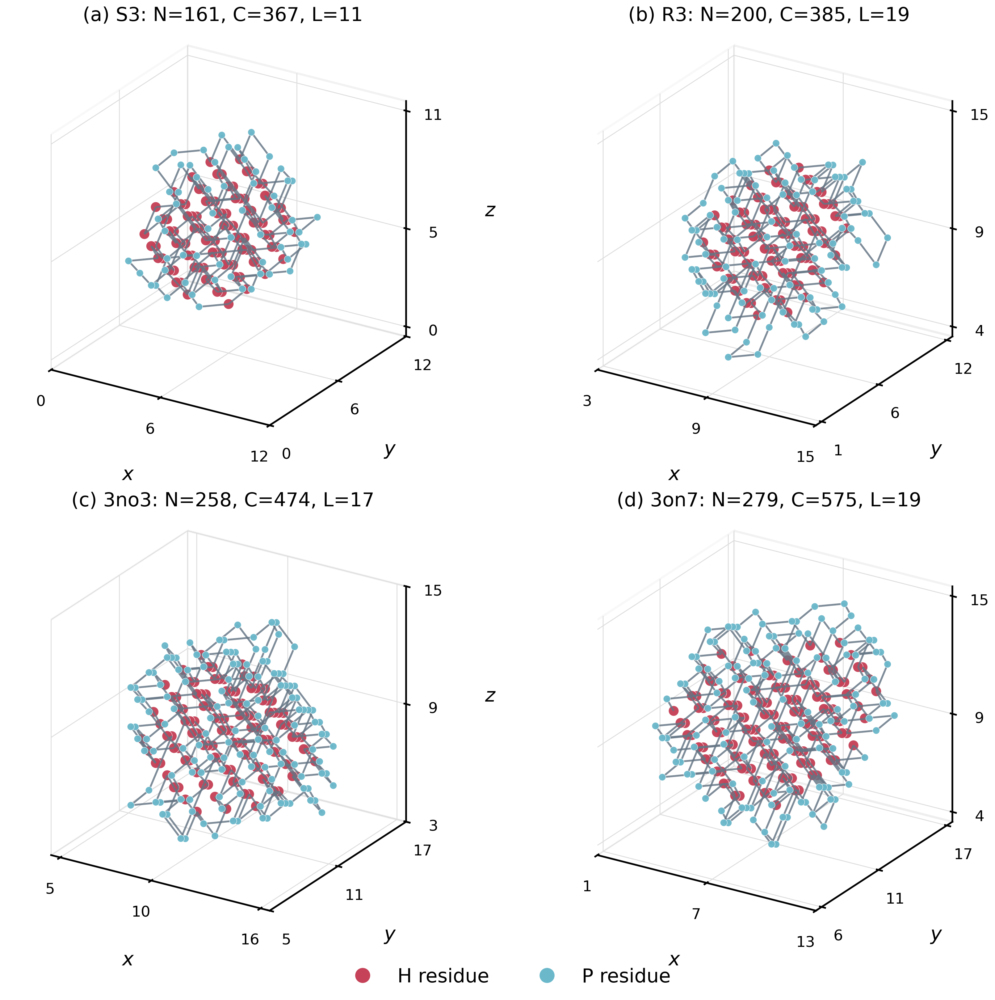

# CMHA-HP-FCC

**Contact-Guided Multi-Block Heat-Bath Annealing** for protein-folding optimization
on the three-dimensional **face-centered cubic hydrophobic-polar (FCC HP) lattice**.

CMHA reconstructs one to four separated residue intervals in a shared stochastic
beam, evaluates complete assignments jointly, and directly samples the next fold
from temperature-dependent candidate weights. Search starts from fresh,
sequence-aware self-avoiding walks, without a precomputed hydrophobic-core database.

This repository contains the original mixed CMHA implementation, numerical
profiles and compact evidence supporting the accompanying study. It is **not**
the later TPC-160K temperature variant, nor a relabeling of earlier simple-cubic
Q-RBHA results.

## Quick start

Use **Python 3.12**. The reference environment used Python 3.12.7, NumPy 1.26.4,
Numba 0.60.0 and Matplotlib 3.9.2. Dependencies are pinned in `requirements.txt`.

```bash
python -m pip install -r requirements.txt
python run_cmha.py --list-benchmarks
python run_cmha.py --benchmark H1 --dry-run
python run_cmha.py --benchmark H1
```

The final command uses the reported H1 profile: 16 parallel workers, a maximum
3,600-second annealing budget per worker, and individual worker stopping at the
Native reference. Initial walk generation, JIT preparation and export are additional
process overhead. First execution can spend substantial time compiling Numba kernels.

New output goes to `runs/<benchmark>/<unique-run-name>/`. Existing experiments
are never overwritten. `--dry-run` validates and prints the effective configuration
without starting annealing or creating an experiment directory.

For a deliberately small software test:

```bash
python run_cmha.py --benchmark H1 --workers 2 --wall-seconds 3 --max-proposals 64 --target-stop disabled
```

Overrides are recorded in `cmha_invocation.json`; this is a test configuration,
not a reproduction of a reported fixed-budget result.

## Benchmarks and results

| Collection | Instances | Residues | Lattice side | Annealing limit |
| --- | ---: | ---: | --- | --- |
| Harvard H1-H10 | 10 | 48 | 8 | 1 h; individual target stopping |
| F90 | 5 | 90 | 9 | 1 h; individual target stopping |
| S1-S4 | 4 | 135-164 | 11 | 1 h; individual target stopping |
| F180 | 3 | 180 | 12 | 3 h; full budget |
| R1-R3 | 3 | 200 | 19 | 3 h; full budget |
| CASP9-derived | 6 | 179-279 | 12, 13, 14, 15, 17, 19 | 6 h; full budget |

Each profile uses sixteen worker seeds `21013001 + 1000003 * worker_id`.
Exact HP strings, H counts and sequence hashes are in [benchmarks.csv](benchmarks.csv).
S3 is the literal **161-residue** sequence, not the inconsistent 162-residue label.

- [PRIMARY_RESULTS.csv](results/PRIMARY_RESULTS.csv): compact primary results with relative artifact links.
- [RESULT_FCC_CMHA.csv](results/RESULT_FCC_CMHA.csv): detailed primary records and parameters.
- [RESULT_FCC_ablation_comparison.csv](results/RESULT_FCC_ablation_comparison.csv): the complete matched component panel.
- [worker_best_folds.csv](results/worker_best_folds.csv): all 944 primary/ablation worker-best coordinate records.
- [best_folds/](results/best_folds/): one independently validated best fold for each primary instance.
- [examples/H1/](examples/H1/): a compact measured example with initial walks and sixteen worker results.

The reported primary collection matches 25 published Native reference energies.
Among 21 sequence-matched IWL comparisons, it improves 13 best energies, matches
six and remains three contacts below IWL on both 3mr7 and 3no3. These are
best-solution-quality comparisons, not matched cross-study runtime rankings.
Native reference matching is not a new optimality certificate.

**Means and sample SDs describe worker-best folds within one parallel execution,**
not repeated complete sixteen-worker experiments. Zero SD in all-worker
target-stopped cases is conditional on that stopping policy. The separate
independent-seed confirmation batch is outside this release's reported study.

## Run a suite or ablation

Batch commands first print a plan. Add `--execute` to start simulations.
Benchmarks run sequentially; workers within each benchmark run in parallel.

```bash
python run_batch.py --suite F90
python run_batch.py --suite F90 --execute
python run_batch.py --suite all --order longest-first
python run_cmha.py --benchmark 3no3 --ablation without_direct_heat_bath --dry-run
python run_batch.py --ablation single_block
```

The full 31-instance plan has a **73-hour maximum annealing allowance** before
setup/export overhead; target stopping can shorten the easier suites considerably.
Do not mistake sixteen parallel worker budgets for sixteen times the benchmark's
elapsed wall allowance.

Seven configurations are available on F180_1FCC, R3FCC, 3mr7 and 3no3:
full CMHA, single block only, single plus paired (J2), without P-run windows,
without contact conditioning, without compact-core shaping, and without direct
heat bath. The transition ablation has a separate frozen engine snapshot.
See [docs/ABLATIONS.md](docs/ABLATIONS.md) and [commands/COMMANDS.csv](commands/COMMANDS.csv).

## Validate and regenerate

```bash
python -m unittest discover -s tests -v
python tools/validate_results.py
python tools/verify_repository.py
python tools/build_assets.py
python tools/summarize_run.py --run-dir examples/H1 --check-only
```

Validation checks box bounds, FCC parity, site exclusivity, every chain link,
two independent H-H contact counts, sequence hashes, means and sample SDs.
Figure/table generation uses only bundled data and does not run simulations.
The [local validation record](validation/LOCAL_VALIDATION.json) documents 20
passing tests and two short parallel software checks. Hosted CI runs after upload.



Examples are S3, R3, 3no3 and 3on7. Red beads are H residues, blue beads are P
residues, and lines are chain links. Only the first two recover their tabulated
Native references; the other panels are not claimed ground states.

## Method and reproducibility

The effective annealing score is `-2*C_HH - 0.5*lambda*C_excess`, while reported
physical HP energy is `-C_HH`. Compact-core shaping is a decoded structural term,
not an unaugmented pairwise QUBO. Direct heat-bath selection is conditional on a
biased, finite candidate pool; no global equilibrium-sampling guarantee is claimed.

The reconstruction, scoring and controller code is preserved from the validated
snapshot. Historical names inside `engines/` are retained for traceability;
`run_cmha.py` is the public entry point. Fresh initialization, archives,
temperature caps and terminal cooling are documented in
[docs/ALGORITHM.md](docs/ALGORITHM.md).

Identical seeds do not guarantee identical wall-budget trajectories across
machines or CPU loads. See [docs/REPRODUCIBILITY.md](docs/REPRODUCIBILITY.md),
[docs/DATA_DICTIONARY.md](docs/DATA_DICTIONARY.md) and
[data/LITERATURE_PROVENANCE.md](data/LITERATURE_PROVENANCE.md).

## Citation and license

Use [CITATION.cff](CITATION.cff) to cite the software hosted at
[Mohaimenul-Peyal/CMHA-HP-FCC](https://github.com/Mohaimenul-Peyal/CMHA-HP-FCC).
Source and original accompanying materials are released under the
[MIT license](LICENSE). Benchmark and dependency attribution is in [NOTICE.md](NOTICE.md).

Authors: **Md Mohaimenul Alam, Naoya Onizawa and Takahiro Hanyu**, Tohoku University.
